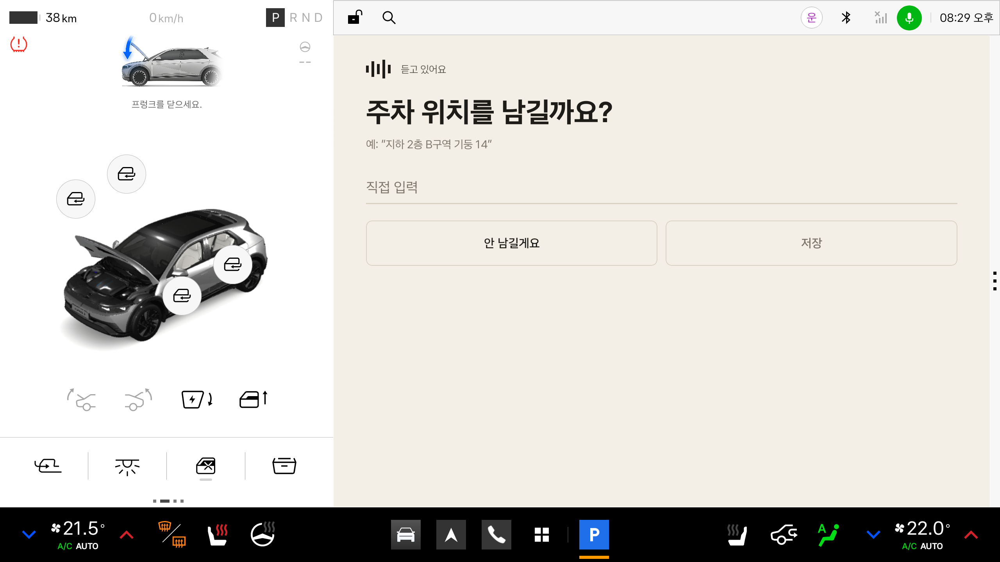
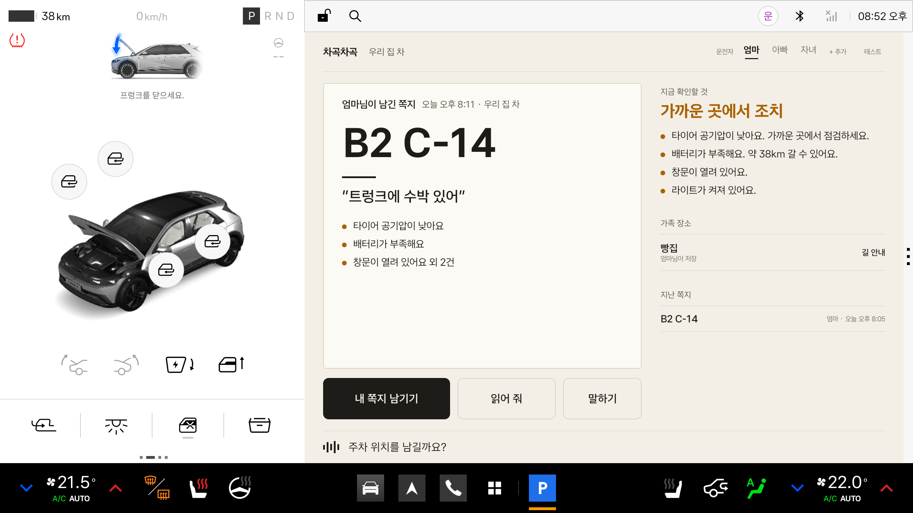
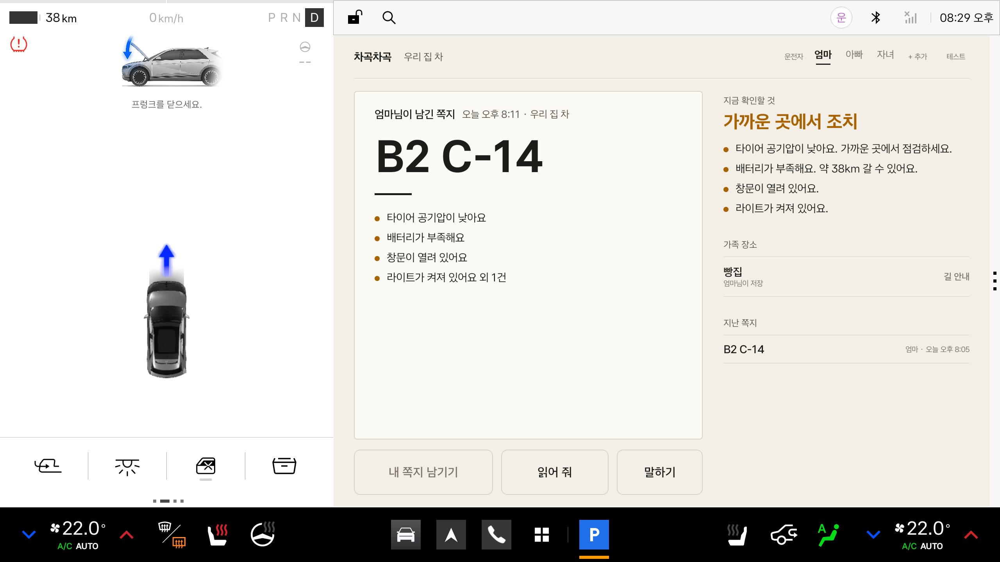
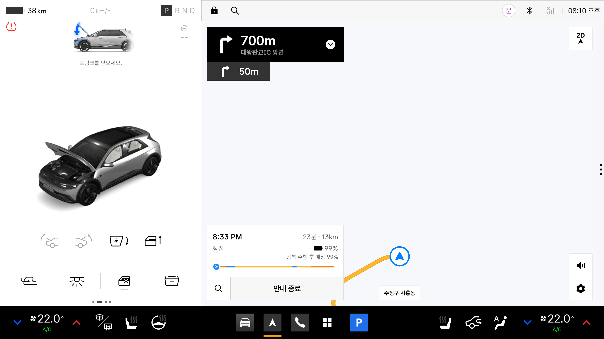

# 차곡차곡

> GPS가 알려주지 못하는 '지하 2층 B구역 기둥 14'를 음성 한마디로 기록하고, 차를 넘겨받는 사람에게 주차 위치와 차 상태를 차가 먼저 알려주는 **차량 인수인계 앱**

현대자동차그룹 차량용 앱 개발 공모전 출품작 · Pleos Connect 기반 차량용 Android 앱

📄 **주제 정리 한 장 요약: [docs/planning.md](docs/planning.md)**

---

## 📸 실행 화면

Pleos Connect Emulator 2.1.0에서 실제로 실행한 화면입니다. (2560×1440, 2026-11-12 캡처)

| ① 주차하면 차가 먼저 묻기 | ② 다음 운전자에게 남긴 쪽지 |
|---|---|
|  |  |
| 기어를 **P단**에 두면 "주차 위치를 남길까요?"라고 묻고 음성으로 받아 적습니다. 음성이 안 될 때는 직접 입력합니다. | 주차 위치 **B2 C-14**, 한마디("트렁크에 수박 있어"), 차 상태와 **3단계 등급**(가까운 곳에서 조치)을 한 장의 쪽지로 보여줍니다. |
| **③ 주행 중** | **④ 음성 장소 핀 → 길 안내** |
|  |  |
| 기어가 **D단**이면 화면 조작 버튼을 막고, 상태 이상은 음성 한 줄로만 안내합니다. | "그 빵집 안내해 줘"라고 말하면 **NaviHelper SDK**로 저장한 장소 길 안내가 시작됩니다. |

---

## 📌 앱 소개

차 한 대를 여러 사람이 나눠 쓰는 가정에서는 "차 어디에 댔어?", "기름 남아 있어?"라는 질문이 반복됩니다.
차곡차곡은 차가 정차 순간을 감지해 **먼저 묻고**, 운전자의 한마디를 받아 적어 **다음 운전자와 가족에게 건네는** 인수인계의 바통 역할을 합니다.

### 주요 기능

| 기능 | 설명 |
|---|---|
| 🅿️ **주차 음성 메모** (핵심) | 정차를 감지하면 "주차 위치를 남길까요?"라고 묻고, 음성 메모와 원본 음성, 위치, 건물명, 차 상태를 '주차 카드'로 저장해요. 자주 가는 주차장은 기억해서 "응" 한마디로 기록해요 |
| 🔊 **탑승·하차 점검 브리핑** | 다음 사람이 타면(운전석 문이 닫히면) 차가 먼저 쪽지를 읽어 줘요. 탈 때 직전 운전자 기록과 문·창문·타이어·연료 상태를 요약하고, 내릴 때 놓친 것(창문, 라이트)을 알려줘요. 상태 이상은 3단계 등급으로 안내하고 기록해요 |
| 💬 **한마디 전하기** | "트렁크에 수박 있다고 전해 줘"라고 말하면 쪽지에 붙고, 다음에 타는 사람에게 차가 읽어 줘요 |
| 📍 **음성 장소 핀** | "여기 다음에 오자"라고 말한 장소를 가족과 공유하고 내비 길 안내로 연결해요 |
| 👨‍👩‍👧 **가족 연결** | 차 화면의 QR로 가족 그룹에 참여해요. 휴대폰 웹앱(PWA)에서 주차 카드를 확인하고 원본 음성을 재생해요 |

### 안전·개인정보 원칙
- 주행 중에는 음성으로만 동작하고, 화면 조작은 정차 중에만 허용해요.
- 실시간 위치 추적 없이 주차가 끝난 시점의 위치만 공유해요.
- 원본 음성은 다음 주차 기록이 생기면 자동으로 삭제해요.

---

## 🏗️ 시스템 구성

```
[차량 앱 (Pleos Connect)]  ⇄  [Firebase]  ⇄  [가족 웹앱 (PWA)]
 음성 입력 · 차량 데이터        데이터 저장 · 알림      주차 카드 · 장소 목록
```

| Pleos Connect SDK | 용도 |
|---|---|
| Vehicle SDK | 기어(P단 주차 감지), 문, 창문, 라이트, 타이어·경고등, 연료·배터리, 주행가능거리, 주행거리 |
| SpeechToText SDK | 주차 메모, 장소 핀, 음성 명령 |
| TextToSpeech SDK | 주차 확인 질문, 탑승 브리핑 |
| FusedLocation SDK | 주차·장소 좌표, 자주 가는 주차장 판별 |
| NaviHelper SDK | 저장한 장소로 길 안내 요청 |

---

## ▶️ 실행 방법

### 1. 준비
1. [Android Studio](https://developer.android.com/studio)를 설치합니다.
2. Pleos Connect 전용 에뮬레이터(AVD)를 설치하고 실행합니다. ([설치 가이드](https://document.pleos.ai/docs/connect/guide/getting-started/application-development/setup-connect-sdk-emulator))

### 2. APK로 실행
```bash
adb install apk/차곡차곡_차곡차곡_release.apk
```
런처에서 **차곡차곡**을 실행합니다.

### 3. 소스에서 빌드
Android Studio에서 이 저장소 폴더를 열고 실행(▶)하거나, 터미널에서 빌드합니다. (JDK 17 필요)
```bash
./gradlew assembleRelease
```
```bash
./gradlew testDebugUnitTest
```
빌드 결과는 `app/build/outputs/apk/release/app-release.apk`에 생깁니다.

### 4. 써 보기
- **Pleos Connect Virtual Console**(`adb forward tcp:8088 tcp:8088` 뒤 브라우저에서 `http://127.0.0.1:8088/`)에서 기어를 D → P로 바꾸면 차가 "주차 위치를 남길까요?"라고 묻습니다. 창문·라이트·주행가능거리·경고등(TPMS)을 바꾸면 차 상태와 등급에 반영됩니다.
- 차량 없이 흐름만 볼 때는 화면 오른쪽 위 **테스트 패널**을 켜고 `기어 D` → `기어 P`를 누릅니다. 창문·라이트·타이어·연료 상태도 바꿔 볼 수 있습니다.
- **자주 가는 주차장**: 테스트 패널에서 `위치 집`을 고르고 같은 자리를 두 번 기록하면, 세 번째부터 "평소처럼 …에 주차하셨어요?"라고 묻습니다.
- **한마디 전하기**: `말하기`를 누르고 "트렁크에 수박 있다고 전해 줘"라고 말합니다. 쪽지에 한마디가 붙습니다.
- **탈 때 먼저 읽어 주기**: 쪽지를 남긴 뒤 Virtual Console에서 운전석 문(Door Position > Front left)을 열고 닫기를 두 번 합니다. 첫 번째는 내린 것, 두 번째는 다음 사람이 탄 것으로 보고 차가 쪽지를 읽어 줍니다.
- **화면에 앱이 없을 때**: 내비 등 다른 앱을 띄워 둔 채 기어를 D → P로 바꿔도 차가 음성으로 묻습니다.
- **장소 핀**: `말하기`를 누르고 "여기 다음에 오자", "그 빵집 안내해 줘"라고 말합니다. 테스트 패널의 `말: …` 칩으로도 넣어 볼 수 있습니다.
- 음성 인식을 쓸 수 없는 환경에서는 질문 화면에서 직접 입력해 저장합니다.

### 현재 구현 범위 (1단계 프로토타입)
| 기능 | 상태 |
|---|---|
| P단 진입 감지 → 차가 먼저 질문 | ✅ |
| 음성 메모(STT) → 주차 카드 저장 (운전자, 시각, 좌표, 차 상태) | ✅ |
| 내릴 때 점검 (창문, 라이트) | ✅ |
| 탑승 브리핑, 3단계 등급 규칙표 | ✅ |
| 운전 중 상태 이상 음성 한 줄 안내 | ✅ |
| 자주 가는 주차장: 평소 자리를 먼저 제안, "응" 한마디로 기록 | ✅ |
| 음성 장소 핀("여기 다음에 오자") 저장, 저장한 장소로 길 안내 요청(NaviHelper) | ✅ |
| 차 이름·가족 구성 설정 (집에 차가 여러 대일 때 구분, 운전자 추가) | ✅ |
| 되풀이되는 이상 기록 ("최근 2주 타이어 공기압 2회") | ✅ |
| 탈 때 차가 먼저 쪽지 읽어 주기 (운전석 문 닫힘으로 탑승 감지) | ✅ |
| 다음 사람에게 한마디 전하기 ("…라고 전해 줘") | ✅ |
| 화면에 앱이 없어도 주차·탑승 감지 (감지 서비스, 음성으로만 진행) | ✅ |
| 원본 음성 보관, 건물명 자동 인식 | 🚧 2단계 |
| 가족 연결(QR·웹앱) | 🚧 2단계 |

> ✅는 코드 구현, 빌드·단위 테스트 통과, Pleos Connect Emulator 2.1.0 동작 확인 기준입니다.

**Pleos Connect Emulator 2.1.0에서 확인한 것 (2026-11-12)**

| SDK | 확인 내용 |
|---|---|
| Vehicle | Virtual Console에서 바꾼 기어(D→P), 창문, 라이트, 주행가능거리, 배터리, 타이어 경고등(TPMS)이 앱에 반영됨 |
| Vehicle (문) | 운전석 문을 두 번 여닫으면 두 번째에 차가 쪽지를 읽어 줌 |
| 감지 서비스 | 내비 앱이 화면에 떠 있는 상태에서 D→P 전환 시 음성 질문과 듣기 시작 |
| TextToSpeech | 주차 질문, 저장 확인, 탑승 브리핑을 차량 음성으로 재생 |
| SpeechToText | P단 진입 뒤 듣기 시작, 말이 없으면 10초 뒤 종료하고 직접 입력으로 전환. 실제 발화 인식 결과는 마이크 연결 후 확인 예정 |
| FusedLocation | 권한 허용 뒤 주차 좌표 수신 |
| NaviHelper | 저장한 장소로 길 안내 요청 → 내비가 경로 안내 시작 ([캡처](docs/screenshots/4_place_navi.png)) |

화면 캡처는 위 [📸 실행 화면](#-실행-화면)과 [docs/screenshots](docs/screenshots/) 폴더에 있습니다.

---

## 🧪 테스트 환경 및 필요한 설정

| 항목 | 버전 / 내용 |
|---|---|
| 실행 환경 | Pleos Connect Emulator 2.1.0 (Android 14, API 34, arm64)에서 확인 |
| 화면 규격 | Pleos Connect Emulator 기본 화면 2560×1440(160dpi), 앱 영역 약 1680×1210에서 확인. 가로·세로(분할 화면) 모두 지원하고 화면 크기에 맞춰 글자와 버튼 크기를 조절 |
| 글꼴 | Asta Sans (Pleos Connect 디자인 가이드 지정, SIL OFL) |
| Pleos SDK | Vehicle 2.3.2, SpeechToText 3.3.1, TextToSpeech 3.3.1, FusedLocation 1.1.3, NaviHelper 3.0.5 |
| 최소 Android API | 28 이상 |
| 개발 언어 | Kotlin |
| JDK | 17 |
| Gradle | 8.0 이상 |
| 권한 | 위치(`pleos.car.permission.FUSED_LOCATION`)는 첫 실행 때 허용을 물어봅니다. 나머지 차량·음성·내비 권한은 설치 시 부여됩니다 |
| 음성 테스트 | 에뮬레이터 Extended Controls > Microphone에서 호스트 마이크 입력을 켭니다 |
| 백엔드 | Firebase (가족 연결용, 2단계에서 추가) |

---

## 📦 APK 위치

- 저장소 내 [`apk/`](apk/) 폴더
- 현재 파일: [`apk/차곡차곡_차곡차곡_release.apk`](apk/차곡차곡_차곡차곡_release.apk)
- 파일명 규칙: `팀명_앱이름_release.apk`
- 용량 초과 시 GitHub Releases에 등록하고 링크를 이곳에 기재합니다.

---

## 📁 폴더 구조

```
├── README.md
├── docs/        기획 문서, 화면 시안, 디자인 기준(docs/design/DESIGN.md)
├── ideas/       아이디어 공유
├── apk/         release APK
├── web/         가족 웹앱 (PWA)
└── app/         차량 앱 (Android · Kotlin · Jetpack Compose)
    └── src/main/java/com/chagok/car/
        ├── vehicle/   Pleos Vehicle SDK 연결 (차 상태)
        ├── voice/     말하기(TTS), 듣기(STT)
        ├── location/  주차 좌표 (FusedLocation)
        ├── parking/   주차 감지, 자주 가는 주차장, 메모 문장 처리
        ├── place/     음성 명령 해석 (장소 저장, 길 안내)
        ├── navi/      길 안내 요청 (NaviHelper)
        ├── briefing/  등급 규칙표, 브리핑 문장, 탑승 감지
        ├── data/      주차 카드 저장
        └── ui/        화면
```

## 🗓️ 개발 일정

| 단계 | 기간 | 범위 |
|---|---|---|
| 1단계 | ~11/15 | 개발 환경 구축, SDK 연동 검증, 주차 음성 메모 프로토타입, 화면 시안 |
| 2단계 | ~12/3 | 가족 연결, 웹앱, 운전자 브리핑, 자주 가는 주차장, 장소 핀·내비 연동 |
| 3단계 | 선정 시 | 안정화, 전시용 APK 테스트 |
